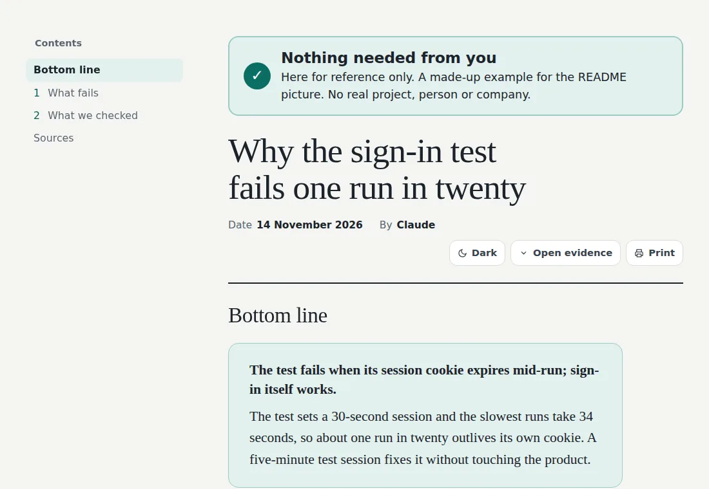
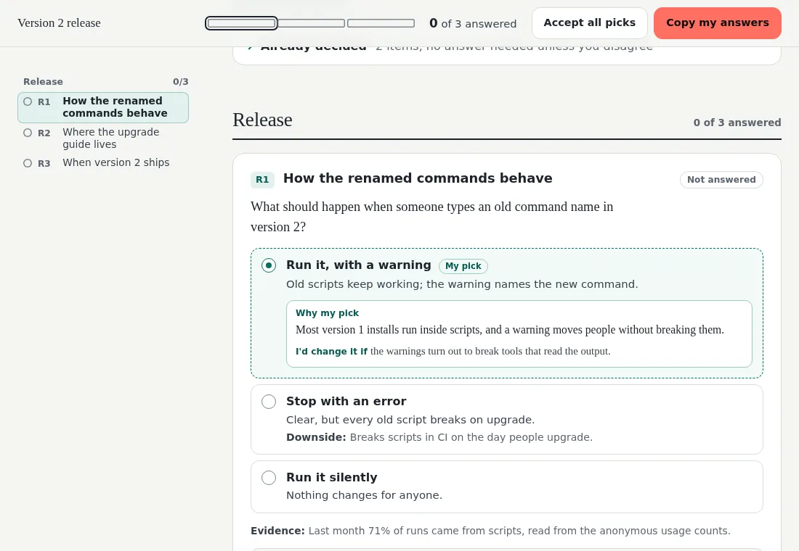
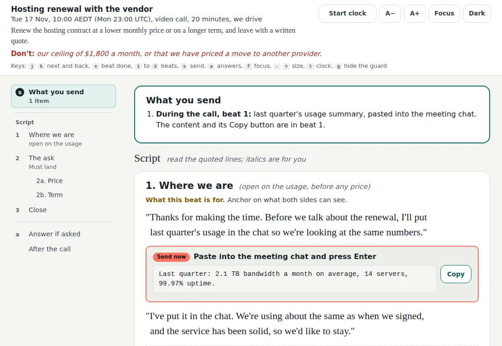
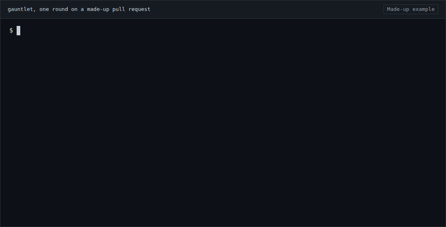
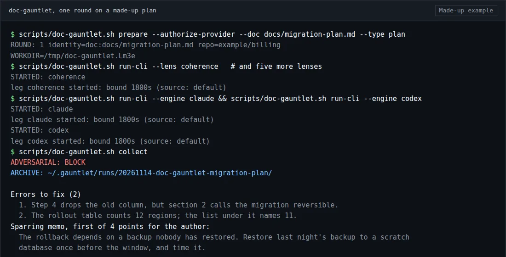

<picture>
  <source media="(max-width: 767px)" srcset="docs/media/banner-phone.webp">
  
</picture>

# Traction skills

Plugins for Claude Code, Codex, Grok and the Claude app: pages you read and rule on, reviews of code, plans and prototypes by independent reviewers, and edits to writing you already have. Each is a skill you ask for in plain words.

## Install

In Claude Code:

```text
/plugin marketplace add Traction-AI-Labs/skills
/plugin install ruling-page@traction
/plugin install reading-page@traction
```

Start with ruling-page and reading-page: neither needs a key or an account. ruling-page needs nothing else; reading-page needs [uv](https://docs.astral.sh/uv/) to build its page.

<!-- install:others:start -->
<details>
<summary>Install the other six</summary>

```text
/plugin install call-prep@traction
/plugin install gauntlet@traction
/plugin install doc-gauntlet@traction
/plugin install persona-teardown@traction
/plugin install humanize-writing@traction
/plugin install go-deeper@traction
```

</details>
<!-- install:others:end -->

## The plugins

<!-- plugins:list:start -->
- [**reading-page**](#reading-page) 0.3.1: Turns a long agent answer into one page you can read. Needs uv.
- [**ruling-page**](#ruling-page) 0.3.1: Puts several decisions with trade-offs on one page you click through. Nothing to install.
- [**call-prep**](#call-prep) 0.3.0: Writes what to say on a call, word for word. Nothing to install.
- [**gauntlet**](#gauntlet) 0.7.1: Reviews a committed code change with two models at once. Needs two signed-in reviewer CLIs (Claude Code and Codex by default). Sends the diff, and whatever the reviewers can read in the worktree, to those two model companies through your own logins.
- [**doc-gauntlet**](#doc-gauntlet) 0.6.2: Reviews a plan or spec before you build from it. Needs two signed-in reviewer CLIs (Claude Code and Codex by default). Sends the document, and whatever the reviewers can read in the worktree, to those two model companies through your own logins.
- [**persona-teardown**](#persona-teardown) 0.2.0: Walks your prototype as three to five cold personas in a real browser. Needs agent-browser. The screens it walks go to the model company of your own session.
- [**humanize-writing**](#humanize-writing) 0.2.0: Rewrites a draft so it reads like a person wrote it, adding nothing. Nothing to install.
- [**go-deeper**](#go-deeper) 0.1.0: Rewrites a task to ask for what a top professional in the field would do. Nothing to install.
<!-- plugins:list:end -->

**Contents:** [Pages you read and rule on](#pages-you-read-and-rule-on) · [Reviews before you merge](#reviews-before-you-merge) · [Writing](#writing) · [Other ways to run them](#other-ways-to-run-them) · [Latest changes](#latest-changes)

## Pages you read and rule on

Each of these writes one self-contained HTML page and opens it for you.

<!-- cards:pages:start -->
### reading-page

Turns a long agent answer into one page you can read.

<picture>
  <source media="(max-width: 767px) and (prefers-color-scheme: dark)" srcset="docs/media/reading-page/phone-dark.webp">
  <source media="(max-width: 767px)" srcset="docs/media/reading-page/phone-light.webp">
  <source media="(prefers-color-scheme: dark)" srcset="docs/media/reading-page/dark.webp">
  
</picture>

<sub>Made-up example, rendered from the plugin's own template by a script.</sub>

**What you get:** A self-contained HTML page built from markdown: the bottom line first, a contents rail, callouts, sortable tables, folded evidence, light and dark, and a phone layout.

**Install:**

```text
/plugin install reading-page@traction
```

**Try it:** ask Claude

> Write up what you found about the flaky sign-in test as a reading page.

**Runs in:** Claude Code, the Claude app, Codex  
**Needs:** [uv](https://docs.astral.sh/uv/), to run its build script.

Version 0.3.1 · [Plugin README](plugins/reading-page/README.md) · [Changelog](CHANGELOG.md)

### ruling-page

Puts several decisions with trade-offs on one page you click through.

<picture>
  <source media="(max-width: 767px) and (prefers-color-scheme: dark)" srcset="docs/media/ruling-page/phone-dark.webp">
  <source media="(max-width: 767px)" srcset="docs/media/ruling-page/phone-light.webp">
  <source media="(prefers-color-scheme: dark)" srcset="docs/media/ruling-page/dark.webp">
  
</picture>

<sub>Made-up example, rendered from the plugin's own template by a script.</sub>

**What you get:** One HTML page with a card per decision, the agent's pick already selected, the other options as buttons, and Copy my answers to paste the result back into chat.

**Install:**

```text
/plugin install ruling-page@traction
```

**Try it:** ask Claude

> I need to decide how the renamed commands behave, where the upgrade guide lives and when version 2 ships. Give me a ruling page.

**Runs in:** Claude Code, the Claude app  
**Needs:** Nothing to install.

Version 0.3.1 · [Plugin README](plugins/ruling-page/README.md) · [Changelog](CHANGELOG.md)

### call-prep

Writes what to say on a call, word for word.

<picture>
  <source media="(max-width: 767px) and (prefers-color-scheme: dark)" srcset="docs/media/call-prep/phone-dark.webp">
  <source media="(max-width: 767px)" srcset="docs/media/call-prep/phone-light.webp">
  <source media="(prefers-color-scheme: dark)" srcset="docs/media/call-prep/dark.webp">
  
</picture>

<sub>Made-up example, rendered from the plugin's own template by a script.</sub>

**What you get:** One HTML page to read on a second screen during the call: a line of what not to say, numbered beats with the exact words, a send box with its own Copy button, and answers to the hardest questions.

**Install:**

```text
/plugin install call-prep@traction
```

**Try it:** ask Claude

> Prep me for a 20-minute renewal call with our hosting vendor on Tuesday at 10am. I want a lower price or a longer term.

**Runs in:** Claude Code, the Claude app  
**Needs:** Nothing to install.

Version 0.3.0 · [Plugin README](plugins/call-prep/README.md) · [Changelog](CHANGELOG.md)
<!-- cards:pages:end -->

## Reviews before you merge

gauntlet and doc-gauntlet have two models review the same pinned change or document, neither seeing the other's findings. persona-teardown walks a prototype in a browser.

<!-- cards:reviews:start -->
### gauntlet

Reviews a committed code change with two models at once.

<picture>
  <source media="(max-width: 767px) and (prefers-reduced-motion: reduce)" srcset="docs/media/gauntlet/poster-phone.webp">
  <source media="(prefers-reduced-motion: reduce)" srcset="docs/media/gauntlet/poster.webp">
  <source media="(max-width: 767px)" srcset="docs/media/gauntlet/round-phone.gif">
  
</picture>

<sub>Made-up example: a scripted replay of one round, the runner's own lines and then the summary the skill writes.</sub>

**What you get:** Findings from Claude and Codex by default (Grok can take either slot), merged into one verdict with each finding's file and line, and every run archived on your machine.

**Install:**

```text
/plugin install gauntlet@traction
```

**Try it:** ask Claude

> Run a gauntlet on this branch.

**Runs in:** Claude Code, Codex, Grok, or the portable CLI  
**Needs:** Bash, Git, Python 3, GNU `timeout`, and two reviewer CLIs signed in: Claude Code and Codex by default, Grok in either slot.

> [!IMPORTANT]
> Use a dedicated clean worktree with no secrets the providers can read. `prepare` requires
> `--authorize-provider`: that flag sends the pinned diff or document, and whatever the reviewer can read
> in the worktree, to those providers.

<details>
<summary>Before you run it</summary>

The two gauntlets need Bash, Git, Python 3 and GNU `timeout` (on macOS, `brew install coreutils`).
Authenticate the CLIs in the pair you will prepare (`claude` and `codex` by default; `grok` if you pass
`--engines`). The Codex reviewer defaults to `gpt-6.1-sol`, which needs Codex CLI 0.159.3 or
later.

The default pair is Claude and Codex. Pass `--engines grok,codex` or `--engines claude,grok` to put Grok
in one slot. Choose the pair at prepare.

</details>

Version 0.7.1 · [Plugin README](plugins/gauntlet/README.md) · [Changelog](CHANGELOG.md)

### doc-gauntlet

Reviews a plan or spec before you build from it.

<picture>
  <source media="(max-width: 767px)" srcset="docs/media/doc-gauntlet/round-phone.webp">
  
</picture>

<sub>Made-up example: a scripted replay of one round, the runner's own lines and then the summary the skill writes.</sub>

**What you get:** Six single-angle reviews (coherence, feasibility, scope, product, security, design), then the same two-model pair, returning a short list of errors to fix and a memo of points for you to decide on.

**Install:**

```text
/plugin install doc-gauntlet@traction
```

**Try it:** ask Claude

> Run a doc-gauntlet on docs/migration-plan.md.

**Runs in:** Claude Code, Codex, Grok, or the portable CLI  
**Needs:** Bash, Git, Python 3, GNU `timeout`, and two reviewer CLIs signed in: Claude Code and Codex by default, Grok in either slot.

> [!IMPORTANT]
> Use a dedicated clean worktree with no secrets the providers can read. `prepare` requires
> `--authorize-provider`: that flag sends the pinned diff or document, and whatever the reviewer can read
> in the worktree, to those providers.

<details>
<summary>Before you run it</summary>

The two gauntlets need Bash, Git, Python 3 and GNU `timeout` (on macOS, `brew install coreutils`).
Authenticate the CLIs in the pair you will prepare (`claude` and `codex` by default; `grok` if you pass
`--engines`). The Codex reviewer defaults to `gpt-6.1-sol`, which needs Codex CLI 0.159.3 or
later.

The default pair is Claude and Codex. Pass `--engines grok,codex` or `--engines claude,grok` to put Grok
in one slot. Choose the pair at prepare.

</details>

Version 0.6.2 · [Plugin README](plugins/doc-gauntlet/README.md) · [Changelog](CHANGELOG.md)

### persona-teardown

Walks your prototype as three to five cold personas in a real browser.

<sub>Made-up example.</sub> Two ledger rows and two findings from a walk:

```text
ledger   checkout  "Pay now"      error  390   dark   reached
ledger   orders    "Load more"    empty  1440  light  reached

major        CONTRAST-SUSPECT  checkout  "Card declined" is red text on a dark red panel (390, dark)
wrong-claim  WRONG-CLAIM       orders    "No orders yet" shows for a customer with 2 orders while the list loads
```

**What you get:** One report per persona: a ledger of every screen, control and state it reached, one finding per line with a screenshot, merged into one amendment prompt for your design tool.

**Install:**

```text
/plugin install persona-teardown@traction
```

**Try it:** ask Claude

> Tear down the prototype at localhost:8787 as a first-time buyer, a support agent and the shop owner.

**Runs in:** Claude Code, Codex  
**Needs:** `agent-browser` installed. It starts one subagent per persona, so the screens it walks go to the model company of the session you run it in.

Version 0.2.0 · [Plugin README](plugins/persona-teardown/README.md) · [Changelog](CHANGELOG.md)
<!-- cards:reviews:end -->

## Writing

Both edit text you already have and return it in chat.

<!-- cards:writing:start -->
### humanize-writing

Rewrites a draft so it reads like a person wrote it, adding nothing.

<sub>Made-up example.</sub> From the skill's own worked examples, about an invented business.

**Before**

> Hi Mei,
>
> I hope this email finds you well! I'm writing to give you a quick update on the bathroom renovation at your Coogee property.
>
> I know delays can be really frustrating, so I wanted to reach out as soon as possible. Unfortunately, the tiles you selected are back-ordered, and the supplier now expects them on 14 March. This means tiling will start on 17 March instead of 3 March, so the bathroom will be ready around 28 March rather than 14 March.
>
> If you'd prefer, we can switch to a similar in-stock tile and keep the original dates. Just let me know by Friday so we can lock things in.
>
> Please don't hesitate to reach out if you have any questions. We truly appreciate your patience and understanding!
>
> Warm regards,
> Dan

**After**

> Hi Mei,
>
> The tiles you selected for the Coogee bathroom are back-ordered, and the supplier now expects them on 14 March. Tiling will start on 17 March instead of 3 March, so the bathroom will be ready around 28 March rather than 14 March.
>
> If you'd prefer, we can switch to a similar in-stock tile and keep the original dates. Could you let me know by Friday so we can lock things in?
>
> Thanks for your patience.
>
> Dan

**What you get:** The draft back in full with the template phrases cut and each point said once in the writer's voice; every date, figure and ask kept. It returns a clean draft unchanged.

**Install:**

```text
/plugin install humanize-writing@traction
```

**Try it:** ask Claude

> Humanize this email before I send it.

**Runs in:** Claude Code, the Claude app, Codex  
**Needs:** Nothing to install.

Version 0.2.0 · [Plugin README](plugins/humanize-writing/README.md) · [Changelog](CHANGELOG.md)

### go-deeper

Rewrites a task to ask for what a top professional in the field would do.

<sub>Made-up example.</sub> A task and the prompt it becomes.

**Before**

> Write a monthly report on why customers cancel.

**After**

> Read every cancellation from the last six months at the event level: the reason given, the last 30 days of use, and any support tickets before it. Group the reasons by what the customer was trying to do. For the biggest group, find the earliest sign in usage that predicts a cancel, test it on a month you did not use to find it, and say how many cancels it would have flagged a week early.

**What you get:** What a top professional would do that you didn't ask for, the rawest material they'd start from, their methods, an outside judge for the result, and the task rewritten as a prompt you can run.

**Install:**

```text
/plugin install go-deeper@traction
```

**Try it:** ask Claude

> Go deeper on this before you start: write a monthly report on why customers cancel.

**Runs in:** Claude Code, the Claude app, Codex  
**Needs:** Nothing to install.

Version 0.1.0 · [Plugin README](plugins/go-deeper/README.md) · [Changelog](CHANGELOG.md)
<!-- cards:writing:end -->

## Other ways to run them

<details>
<summary>Codex, Grok, the Claude app and the portable CLI</summary>

#### Codex

```
git clone https://github.com/Traction-AI-Labs/skills.git
cp -R skills/plugins/gauntlet/skills/gauntlet ~/.codex/skills/gauntlet
cp -R skills/plugins/doc-gauntlet/skills/doc-gauntlet ~/.codex/skills/doc-gauntlet
cp -R skills/plugins/persona-teardown/skills/persona-teardown ~/.codex/skills/persona-teardown
```

The same pattern works for any other skill (`plugins/<plugin>/skills/<skill>`). To update, remove the
old directory and copy again.

#### Grok

Same copy, destination `~/.grok/skills/<skill>`.

#### The Claude app

ruling-page, call-prep, reading-page, humanize-writing and go-deeper install as upload zips. Build them from the repository root:

```
bash scripts/build-zip.sh ruling-page
bash scripts/build-zip.sh call-prep
bash scripts/build-zip.sh reading-page
bash scripts/build-zip.sh humanize-writing
bash scripts/build-zip.sh go-deeper
```

Each lands in that plugin's `dist/` folder. In the Claude app, open **Customize**, then **Skills**, upload
each zip and check it is switched on. The zips are build outputs; never commit them.

#### Portable CLI

Clone the repo. From `plugins/gauntlet` or `plugins/doc-gauntlet`, follow that directory's README.

</details>

## How this README stays right

- The plugin sections, the install list and `marketplace.json` are written by [`scripts/readme/build.py`](scripts/readme/build.py) from each plugin's `plugin.json` and its card in [`scripts/readme/cards/`](scripts/readme/cards/).
- Every picture is rendered by [`scripts/media/render.sh`](scripts/media/render.sh) from a made-up input in [`docs/examples/`](docs/examples/); [`docs/media/manifest.json`](docs/media/manifest.json) records the fingerprint of each input and picture and the plugin version it was checked at.
- `build.py --check` writes nothing and exits 1, naming the file and the fix, when the README, `marketplace.json` or the pictures have fallen behind the plugins. [`readme-check.yml`](.github/workflows/readme-check.yml) runs it once per pull request, when the pull request is labelled `ready`.

## Latest changes

<!-- changes:latest:start -->
- **All eight plugins** (14 November 2026)
- **gauntlet 0.7.1** (14 November 2026)
- **gauntlet 0.7.0 and doc-gauntlet 0.6.2** (14 November 2026)

Full history: [CHANGELOG.md](CHANGELOG.md)
<!-- changes:latest:end -->

## Licence

MIT. doc-gauntlet includes Every's review kernel, and humanize-writing draws on ideas from several
open-source writing skills; see [NOTICE.md](NOTICE.md).
